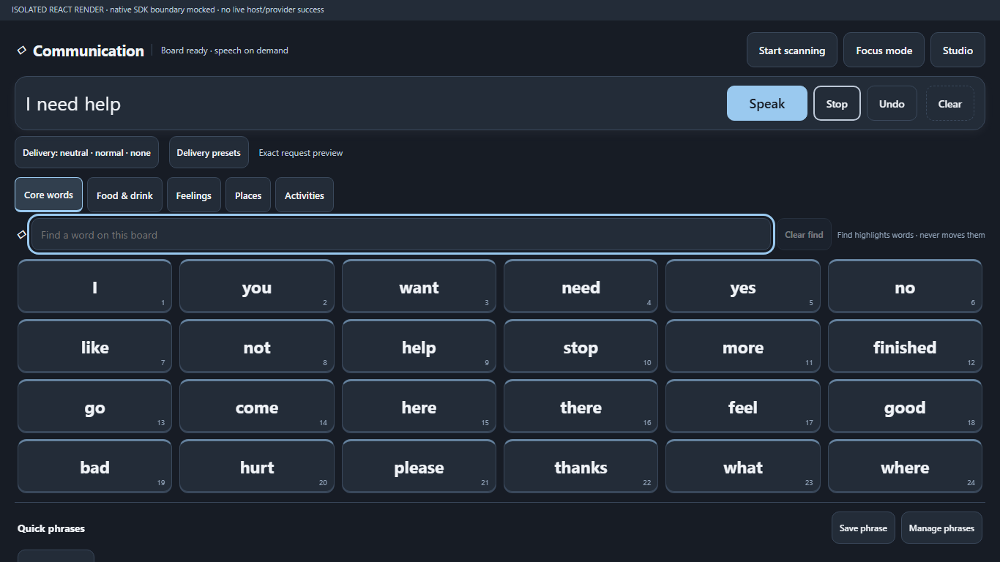
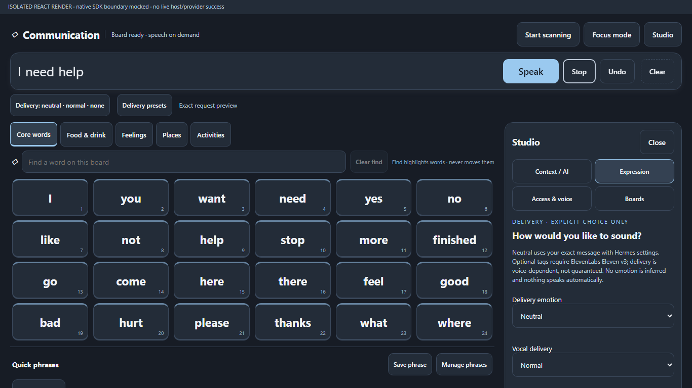
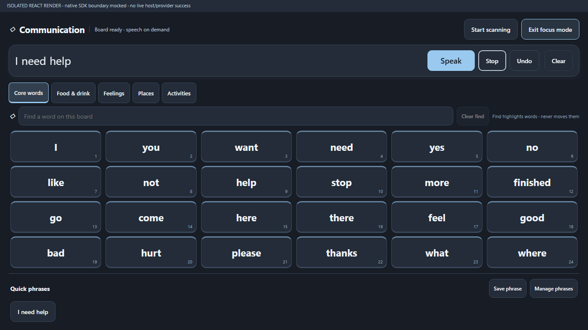

# Hermes AAC

**0.1.0 — experimental Windows desktop plugin by TREE Industries. MIT licensed.**

A communication-first workspace for Hermes Desktop: fixed-position core vocabulary,
category boards, an utterance strip with explicit Speak/Stop, keyboard switch scanning,
find-in-place highlighting, focus mode and explicitly saved quick phrases. Studio adds
personal boards, a constrained Open Board Format JSON import/export, reviewed AI
proposals, voice selection and optional ElevenLabs v3 delivery tags.



## Install from the public repository

Requires **Hermes Desktop v0.21.7 or later**. Windows is the only supported platform
in this initial release; Linux/macOS have not been exercised. Configure Hermes itself
and any desired AI/TTS provider first. The plugin does not bundle providers or keys.

```sh
hermes plugins install https://github.com/TREE-Ind/hermes-aac --ref v0.1.0
```

For reproducible review, replace `v0.1.0` with the full commit SHA shown on the
GitHub release. Review the source/disclosures before approving installation. In
Desktop **Settings → Plugins**, enable **Communication · AAC**, then open **Communication**
in the sidebar (or the **Open Communication board (AAC)** palette command). A packaged
plugin is opt-in. Reload desktop plugins from the palette if necessary. No core patch
or gateway restart is required.

This repository has been submitted for catalog review. **It is not an accepted catalog
listing until NousResearch maintainers merge the catalog PR**; do not assume that
`hermes plugins install hermes-aac` works before then. Updates use new reviewed pins,
not a plugin self-updater.

## Use

- Select tiles to build a message; Speak is always explicit. Stop silences playback
  and discards late audio. Undo removes the last selection; Clear clears the strip.
- Find highlights the fixed grid without moving words. Focus mode hides Studio.
- Start scanning cycles enabled visible targets. Space selects; Escape exits.
  This is keyboard switch scanning, not eye tracking or a certified switch interface.
- Save phrase explicitly persists the current phrase. Manage phrases removes favorites.
- Studio → Boards: create/duplicate a board, preview and approve before activation.
  `.obf` support is a limited plain `open-board-0.1` JSON subset: no `.obz` archives,
  media, linked boards or executable actions. Imported text is rendered literally.
- Studio → Context / AI: review exact text before sending. Suggestions require a click;
  generated boards require approval. AI never automatically speaks or inserts words.
- Voice selection and Eleven v3 activation are staged and explicitly applied to the
  owning Hermes profile, with readback. These settings apply across Hermes, not just AAC.
  Expressive speech requires `elevenlabs` + `eleven_v3`; tags are experimental and may
  not sound as intended. Neutral delivery sends literal words without AAC overrides.

## Authority, privacy and limitations

**Not a medical device, clinical treatment or emergency communication service.** No
clinical efficacy, accessibility certification or reliable offline speech guarantee
is claimed. Keep another communication method available.

- The renderer has the desktop app's authority; error isolation is **not a sandbox**.
  SDK requests use `session.create`, `prompt.submit` and session events. AI is the
  **full configured Hermes agent**, not a restricted vocabulary-only model: configured
  tools, approvals, provider services, session retention and costs still apply.
- The documented authenticated native bridge calls core `GET /api/config`,
  `PUT /api/config`, `GET /api/audio/elevenlabs/voices`, and `POST /api/audio/speak`.
  Voice/catalog/config reads inspect shared Hermes settings beyond plugin-owned data.
  Config writes change only the explicitly selected TTS provider/voice or v3 model field,
  pinned to the reviewed gateway/profile, and read back the result. No settings are
  changed merely by opening the page. These HTTP routes provide audio/config functions
  not exposed as equivalent plugin-owned RPC endpoints.
- Hermes attaches authentication; the plugin never reads credential stores, `.env`,
  `auth.json`, browser profiles, vendor tokens or API keys. No plugin-owned secrets,
  telemetry, shell children, updater or background daemon is registered.
- Explicitly submitted questions/topics and spoken text can go to **third-party
  configured AI/TTS providers**. ElevenLabs catalog browsing contacts the configured
  service through Hermes. Provider policies/costs apply; fallback TTS providers may be
  used by Hermes. Reviewing a prompt is not a promise about provider retention.
- Plugin storage persists approved custom boards, scan settings and **explicitly
  saved phrases in plaintext**, not encrypted. The unsaved utterance strip and proposals
  are not persisted by this plugin. AI requests can be retained in Hermes sessions.
  Board export downloads plaintext JSON. Avoid sensitive content on shared devices.
- **Stop cannot cancel provider synthesis already running** or reverse charges/sharing.
  It pauses local playback and invalidates late audio. AI cancellation/timeout does not
  guarantee cancellation of agent work already accepted by the gateway.
- No cross-platform, live-provider, screen-reader or full released-Electron end-to-end
  compatibility certification is claimed. Source-contract checks against released
  v0.21.7 establish API presence; React tests use mocked SDK/native/provider boundaries.
  The conservative minimum is v0.21.7, not a claim that earlier releases cannot work.

## Verification and screenshots

The screenshots are **actual mounted React renders of this plugin**, using a mocked SDK,
native bridge, synthetic theme and placeholder icon glyphs—not screenshots of a live
provider session. Each screenshot labels that limitation. No private desktop was captured.




The initial release was checked with 45 React/jsdom tests, syntax/import checks,
Python packaging/provider-source fixtures, and native `hermes plugins validate
--install-deps --json` on isolated latest-main and released v0.21.7 sources.
The desktop-only package intentionally has no Python `__init__.py`; the native validator
warns that its Python capability probe is skipped. Empty catalog capabilities describe
Python registrations, **not a JavaScript permission boundary**. No live speech generation
or shared user-config write was performed during publication.

## Develop from a fresh checkout

Node 24+ and Python 3.11+ are required for development. Runtime imports resolve from
Hermes (`@hermes/plugin-sdk`, `react`, `react/jsx-runtime`); npm dependencies below are
**development-only**, locked publicly, and no Hermes internals are vendored.

```sh
git clone https://github.com/TREE-Ind/hermes-aac.git
cd hermes-aac
npm ci
npm test
npm run check
python scripts/verify.py
```

`verify.py` runs all JavaScript tests and Python packaging tests; the optional provider
source fixture is explicitly skipped without `HERMES_SOURCE`. It does not install by
default. `--install --target /explicit/authorized/plugin.js` copies only tested source;
`--package` builds a source-only archive. Never pass another profile as a target unless
you intend to modify it.

For released-source contract/provider fixtures (no provider network or credentials):

```sh
git clone --depth 1 --branch v0.21.7 https://github.com/NousResearch/hermes-agent.git ../hermes-source
# POSIX shell syntax; on PowerShell set $env:HERMES_SOURCE to the absolute checkout path.
HERMES_SOURCE="$(cd ../hermes-source && pwd)" python scripts/check-hermes-contract.py
HERMES_SOURCE="$(cd ../hermes-source && pwd)" python -m unittest discover -s tests -p test_verify.py
```

Use `HERMES_NODE_MODULES` only if intentionally using another checkout's development
dependencies; normal `npm ci` tests need neither that nor `HERMES_SOURCE`.

To reproduce screenshots, `npx playwright install chromium` then `npm run render`.
The harness opens only an ephemeral loopback server, forbids live gateway/provider
calls and tests three viewport geometries. Generated evidence/caches are not committed
unless separately privacy-reviewed. Optional `AAC_BROWSER_EXECUTABLE` selects a local
Chromium binary; it is not bundled. `AAC_TEST_SCRATCH` overrides test scratch space.

Native admission should run on the exact pinned tree in an **isolated Hermes install**:

```sh
hermes plugins validate /absolute/path/to/hermes-aac --install-deps --json
```

Dependency preparation can change the validating install's environment even with no
plugin Python dependencies: do not run it against an active gateway environment.

## License and assets

Copyright (c) 2026 TREE Industries. [MIT](LICENSE). Vocabulary is plain text; no
third-party AAC symbol library, font, audio or binary is redistributed. Development
dependencies retain their respective upstream licenses. Hermes SDK/React/icon resources
are supplied by the host, not copied into the plugin.
